

  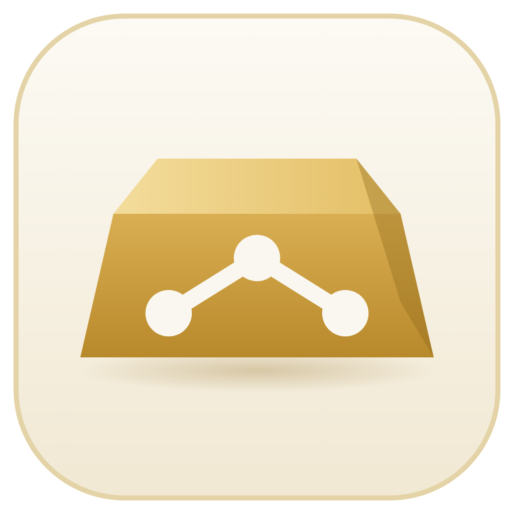

<h1 align="center">Gold Agent — Control Room</h1>

  <b>A team of twelve AI agents that watches, analyses, trades and audits gold (XAUUSD), with every decision visible and every order checked by a deterministic risk engine.</b>

  Project showcase &nbsp;·&nbsp; Source code is private &nbsp;·&nbsp; Not open source &nbsp;·&nbsp; Not investment advice

  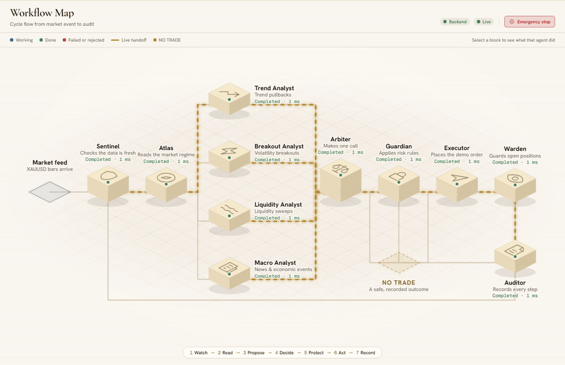

---

## Watch the film

  <a href="https://github.com/ilyasdaoudrma/gold-agent-control-room/releases/download/showcase-video/gold-agent-control-room.mp4">
    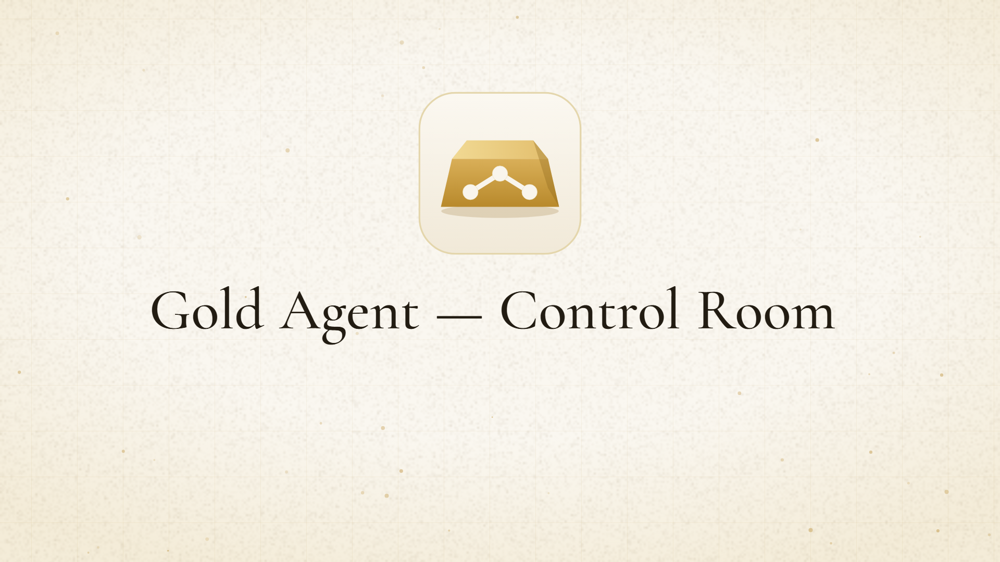
  </a>

  Two-minute film &nbsp;·&nbsp; 2:09, 1080p, MP4 (93 MB) &nbsp;·&nbsp; English subtitles &nbsp;·&nbsp; Voice and sound effects by <a href="https://elevenlabs.io">ElevenLabs</a>

## Read the technical report

  <a href="report/Gold-Agent-Technical-Report.pdf">
    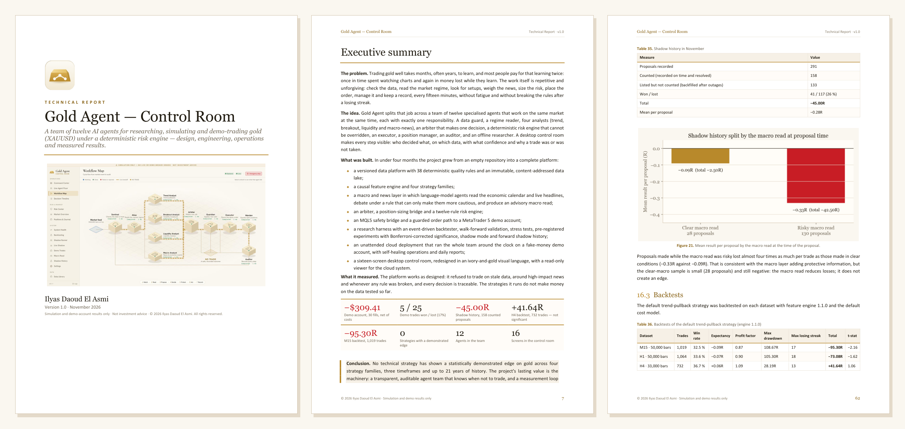
  </a>

  <b><a href="report/Gold-Agent-Technical-Report.pdf">Gold Agent — Control Room: Technical Report (PDF)</a></b> 
  83 pages &nbsp;·&nbsp; 22 chapters &nbsp;·&nbsp; the problem, the twelve agents, the risk and measurement maths, cloud operations, every incident, every result — losses and retracted results included

## The problem

Learning to trade gold well takes months, often years, and most people pay for that time twice: once in hours spent watching charts, and again in money lost while learning. The work itself is repetitive and unforgiving. Someone has to check the data is fresh, read the market regime, look for setups, weigh the news, size the risk, place the order, manage it and keep a record — every fifteen minutes, without fatigue and without breaking the rules after a losing streak.

**Gold Agent splits that job across a team of specialised agents that work at the same time**, each with one responsibility, and puts a rule-based risk engine between every idea and every order. The control room makes the whole process visible: who decided what, on which data, with what confidence, and why a trade was or was not taken.

## How the team works

Every closed 15-minute bar starts one cycle. It moves left to right, and any agent can stop it. When anything is missing, stale or uncertain, the safe outcome is always **NO TRADE**.

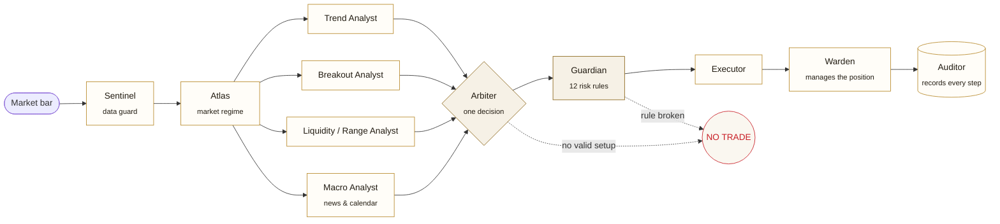

| # | Agent | Its one job |
|---|---|---|
| 1 | **Sentinel** | Checks that market data is complete, fresh and well-formed. Stops the cycle when it is not. |
| 2 | **Atlas** | Classifies the market regime — trending, ranging or volatile — to frame the analysis. |
| 3 | **Trend Analyst** | Looks for pullbacks inside an established trend. |
| 4 | **Breakout Analyst** | Looks for volatility breakouts. Times out safely to "no evidence". |
| 5 | **Liquidity / Range Analyst** | Looks for liquidity sweeps and range reversions. |
| 6 | **Macro Analyst** | Reads the economic calendar and live news; raises a blackout around high-impact events. |
| 7 | **Arbiter** | Combines the evidence into a single decision — or NO TRADE when nothing is valid. |
| 8 | **Guardian** | Applies twelve fixed risk rules. Cannot be bypassed from the interface; sizing is never chosen by a model. |
| 9 | **Executor** | Places the approved order on a fake-money demo account. |
| 10 | **Warden** | Manages the open position. Stops are never widened. |
| 11 | **Auditor** | Records every step in UTC and reconciles state after interruptions. |
| 12 | **Researcher** | Runs offline experiments and backtests; never part of the live cycle. |

More on each agent: [docs/agents.md](docs/agents.md)

## The control room

<table>
  <tr>
    <td width="50%">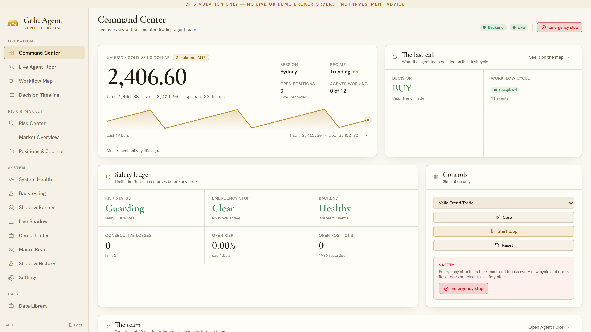 <b>Command Center</b> — price, the last decision, the safety ledger and the team at a glance.</td>
    <td width="50%">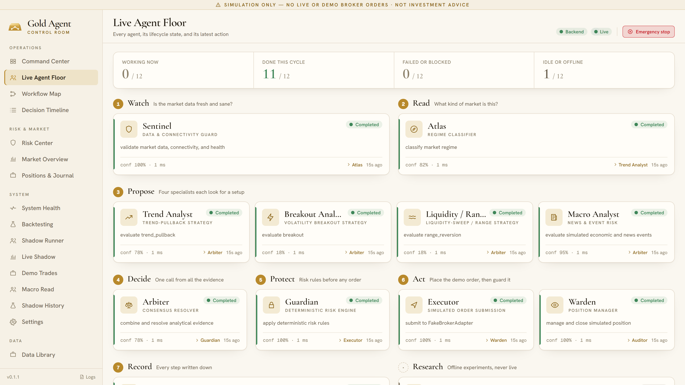 <b>Live Agent Floor</b> — every agent, grouped by the seven steps of a cycle.</td>
  </tr>
  <tr>
    <td>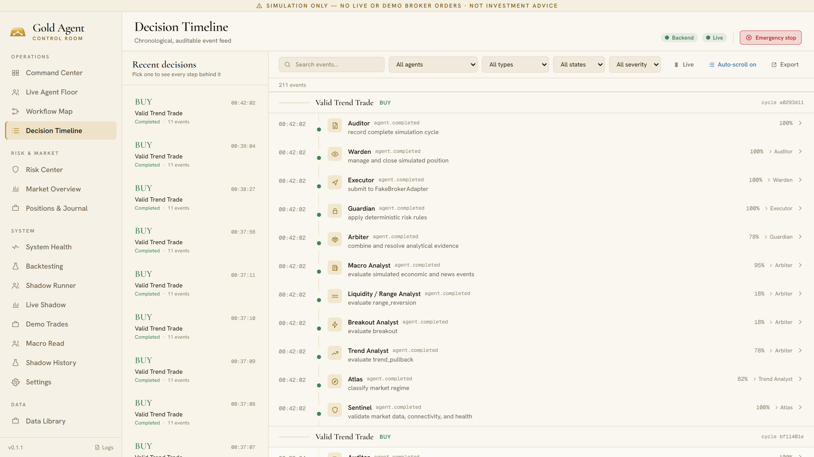 <b>Decision Timeline</b> — each decision and the full, auditable chain behind it.</td>
    <td>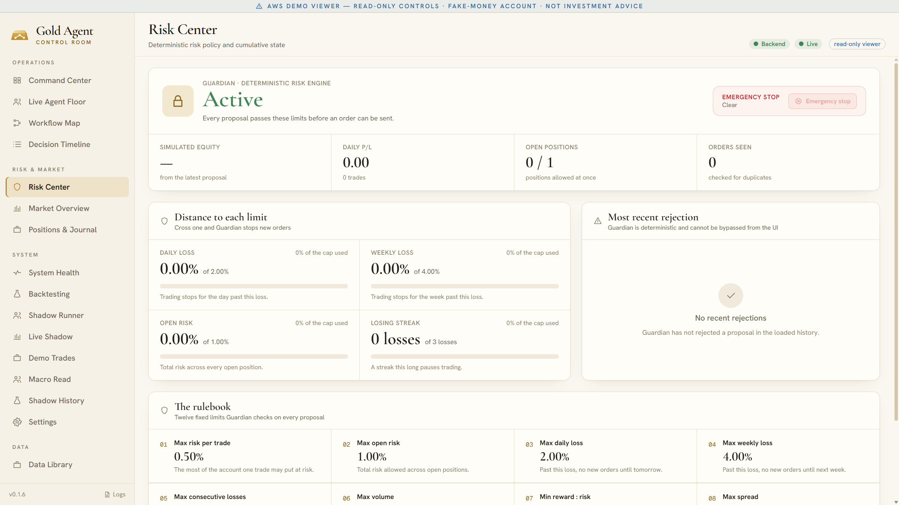 <b>Risk Center</b> — the Guardian's status, headroom to every limit and the rulebook.</td>
  </tr>
  <tr>
    <td>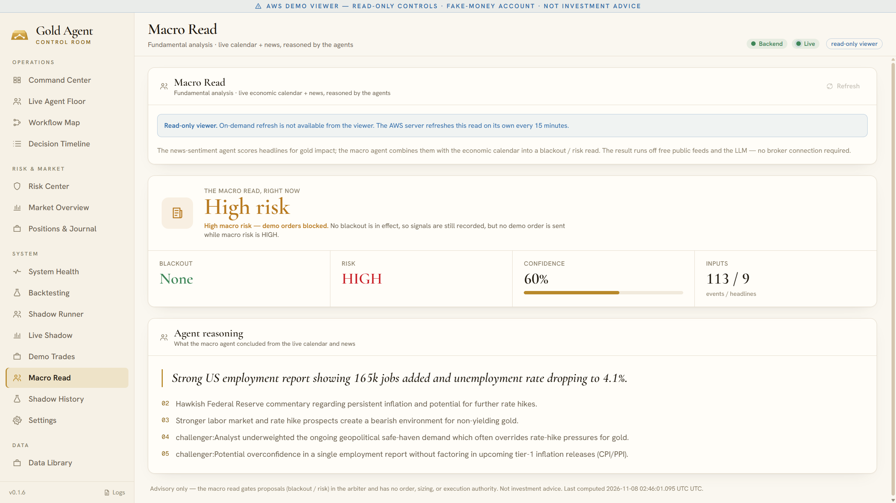 <b>Macro Read</b> — the news and calendar verdict, with the agent's reasoning.</td>
    <td>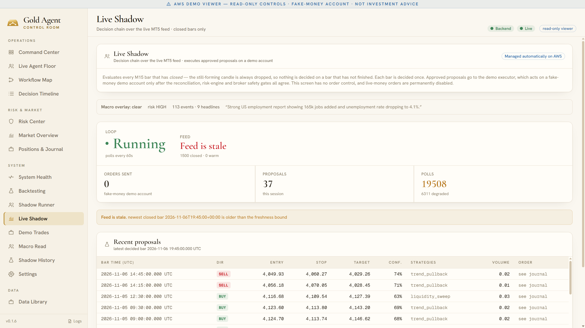 <b>Live Shadow</b> — the live loop on the demo feed and every proposal it made.</td>
  </tr>
</table>

All screens with notes: [docs/screens.md](docs/screens.md)

## Safety is the design, not a feature

- **NO TRADE is the default.** Missing data, a timeout, a disagreement or a broken rule all end the cycle without an order.
- **Twelve fixed risk rules** — 0.5 % risk per trade, 2 % daily and 4 % weekly loss caps, one open position, a pause after three losses in a row, spread, slippage and data-age limits.
- **An emergency stop** halts every cycle and every order, survives restarts, and can only be cleared through a guarded, audited step.
- **No live-money path exists.** Live orders are permanently disabled; the demo runs on a fake-money account, and the remote viewer is read-only.

Details: [docs/safety.md](docs/safety.md)

## Results — measured, not promised

The system was run on a fake-money MT5 demo account on a cloud server, recorded in shadow mode, and backtested over three historical datasets. **No strategy has yet shown a winning edge.**

| Test | What it measured | Result |
|---|---|---|
| Demo account | 30 real fills on a fake-money account | **−$309.41 · −16.37R** · 5 won / 25 lost |
| Shadow history | 158 forward-tracked proposals | **−45.00R** · 41 won / 117 lost |
| Backtest M15 | 50,000 bars · 1,019 trades | **−95.30R** · profit factor 0.87 |
| Backtest H1 | 50,000 bars · 1,064 trades | **−73.08R** · profit factor 0.90 |
| Backtest H4 | 33,000 bars · 732 trades | **+41.64R** · profit factor 1.09 |

  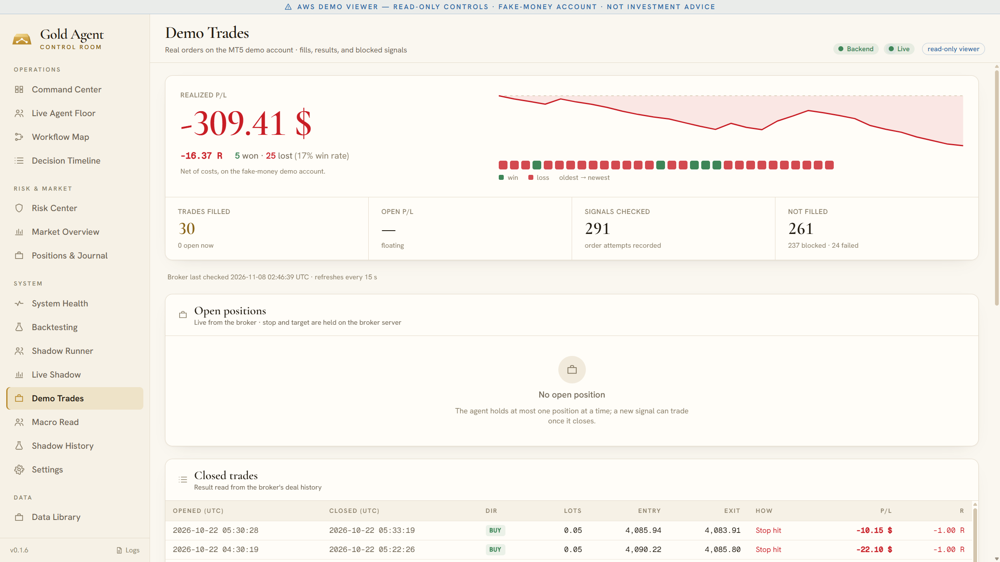
  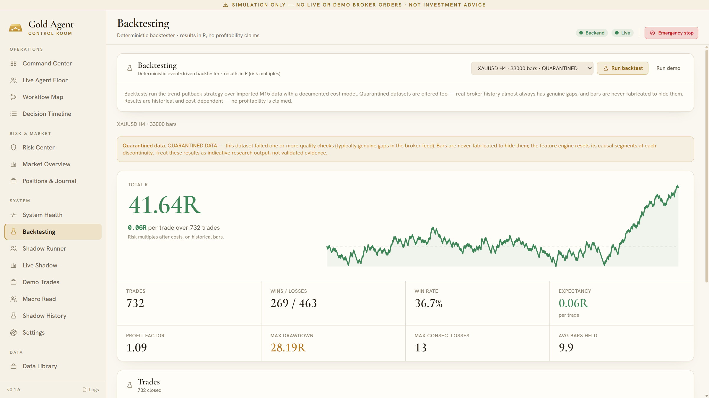

The H4 backtest is the only positive result, and on historical data it is not yet evidence. What the project *has* proven is the machinery: a transparent, auditable agent team that refuses to trade when it should, and an honest measurement loop that says so when a strategy does not work. Full numbers and what they mean: [docs/results.md](docs/results.md)

## Built with

Desktop control room in Electron and React · Python agent service with a REST and WebSocket event stream · SQLite audit store · MetaTrader 5 demo bridge on an AWS server reached through a private, read-only tunnel · a language model for the macro and news read. Architecture overview: [docs/architecture.md](docs/architecture.md) · Product specification: [docs/specification.md](docs/specification.md) · Full technical report: [PDF](report/Gold-Agent-Technical-Report.pdf)

## About this repository

This repository **presents** the project. It contains no source code, no installer and no setup instructions, and none will be published. Gold Agent is a private project and is not open source.

If you are a trader, a prop firm or a team interested in the system — licensing, a private demo, or custom work — **get in touch through [my GitHub profile](https://github.com/ilyasdaoudrma)**.

© 2026 Ilyas Daoud. All rights reserved. Simulation and demo results only. Nothing here is investment advice or a promise of performance.
