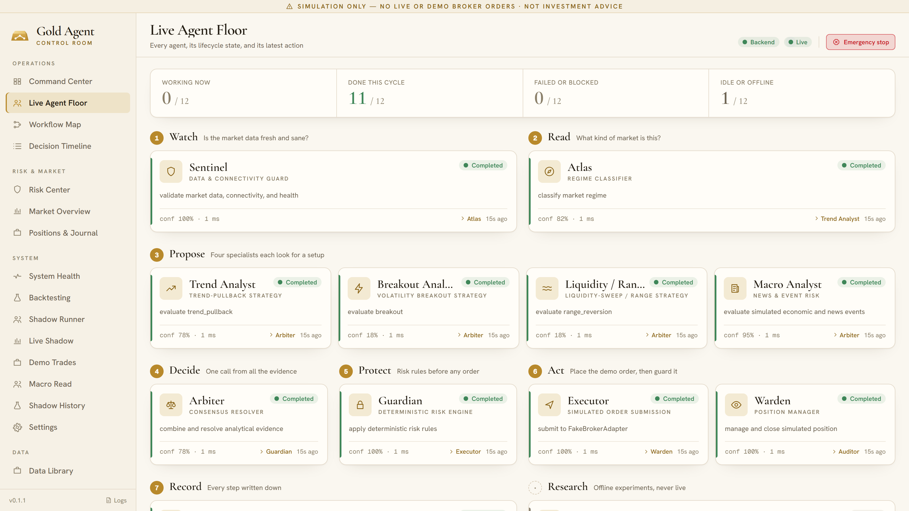

# The agent team

Gold Agent is built as a team, not a single model. Each agent owns one part of a trader's job, works on the same closed 15-minute bar at the same time as its colleagues, and hands its result to the next step. Every agent's state, input, output, confidence, reasoning and timing is shown live in the control room.

## The seven steps of a cycle

| Step | Agents | Question it answers |
|---|---|---|
| 1 · Watch | Sentinel | Is the market data fresh and sane? |
| 2 · Read | Atlas | What kind of market is this? |
| 3 · Propose | Trend, Breakout, Liquidity / Range, Macro | Does any specialist see a setup — and is it safe to trade the news? |
| 4 · Decide | Arbiter | What is the one call, given all the evidence? |
| 5 · Protect | Guardian | Does the call respect every risk rule? |
| 6 · Act | Executor, Warden | Place the order, then guard the position. |
| 7 · Record | Auditor | Write every step down. |

A Researcher works beside the team, offline only.

## Each agent

### Sentinel — data and connectivity guard
Validates incoming market data, the broker connection and system health before anything else runs. If the newest closed bar is older than the freshness limit, or data is missing or malformed, Sentinel fails the cycle and the result is NO TRADE. On a weekend, when the gold market is closed, this is what keeps the whole team idle.

### Atlas — regime classifier
Reads the market regime — trending, ranging or volatile — with a confidence score, so that each strategy is judged in the context it was designed for.

### Trend Analyst — trend-pullback strategy
Looks for a pullback inside an established trend and emits directional evidence (buy, sell or none) with a confidence score, an entry, a stop and a target.

### Breakout Analyst — volatility-breakout strategy
Looks for volatility breakouts. It has a strict time budget: if it cannot finish in time it returns "no evidence" rather than holding up the cycle.

### Liquidity / Range Analyst — liquidity-sweep and range strategy
Looks for liquidity sweeps beyond recent highs and lows, and for range-reversion setups.

### Macro Analyst — news and economic-event risk
Combines the live economic calendar with scored news headlines into a macro read — clear, high risk or blackout — refreshed every 15 minutes. A blackout around a high-impact event blocks new trades. The read is advisory: it can stop a trade, never start one or size one.

### Arbiter — consensus resolver
Combines the specialists' evidence into one decision: buy, sell or NO TRADE. When the evidence conflicts, or no valid setup exists, the answer is NO TRADE.

### Guardian — deterministic risk engine
Checks every proposal against twelve fixed rules (see [safety.md](safety.md)). A rejection forces NO TRADE and is recorded with the rule that caused it. The Guardian is ordinary deterministic code: no model chooses risk or position size, and the interface cannot override it.

### Executor — order submission
Submits only Guardian-approved orders. In the local app it uses a simulated broker; on the cloud demo it places orders on a fake-money MetaTrader 5 demo account. There is no path to a live-money account.

### Warden — position manager
Manages the open position until its stop or target. Stops are never widened.

### Auditor — audit and reconciliation
Records the complete cycle in UTC, reconciles state with the broker after an interruption, and captures every emergency-stop event. The audit trail is the source of truth for every number in [results.md](results.md).

### Researcher — experiment framework
Runs backtests, walk-forward tests, stress tests and shadow runs over historical data, entirely offline. It never touches the live cycle.

## Why a team

- **One responsibility each** makes every failure visible and every decision explainable — the Decision Timeline shows exactly which agent said what.
- **Parallel specialists** mean a new strategy is a new analyst, not a rewrite.
- **A hard boundary between ideas and money.** The agents that look for trades never control risk; the agent that controls risk never looks for trades.
