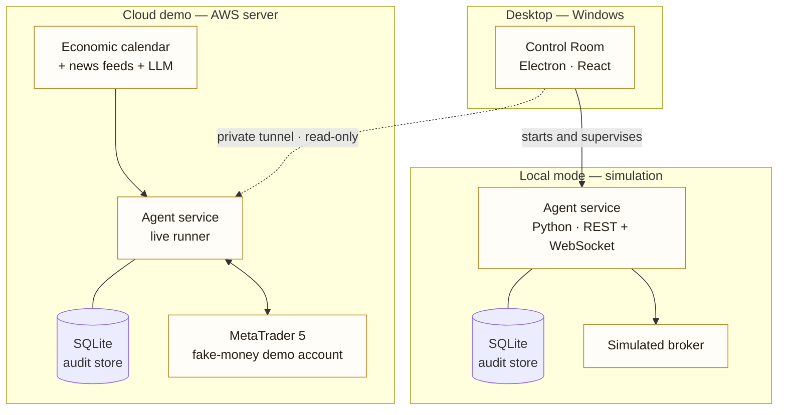

# Architecture overview

A high-level view of how the pieces fit. Implementation details are private.

## Building blocks

| Layer | Role |
|---|---|
| **Control Room** | Desktop app. Shows the team live through an event stream; holds no trading logic. |
| **Agent service** | Runs the agents, the Arbiter, the Guardian and the executor; publishes every lifecycle event. |
| **Audit store** | Append-only record of every cycle, decision, order and safety event — the source of every reported number. |
| **Simulated broker** | Local mode only: deterministic fills for scenarios and tests. |
| **MetaTrader 5 bridge** | Cloud demo only: market data and orders on a fake-money demo account, behind a safety layer. |
| **Macro inputs** | Economic calendar and public news headlines, scored by a language model into an advisory macro read. |
| **Research tools** | Data library, backtester, walk-forward and stress tests, shadow runner — offline only. |

## Two ways to run

- **Local simulation.** The desktop starts and supervises its own agent service. Trading mode is locked to simulation.
- **Cloud demo viewer.** The agent service runs 24/5 on a cloud server against the demo account. The desktop reaches it only through a private tunnel with a read-only credential — it can display everything and change nothing. Nothing on the server is exposed to the internet.

## Principles

- Deterministic where money is concerned: risk, sizing and order rules are plain code with tests, never a model's choice.
- Observable by default: every agent reports state, inputs, outputs, confidence, reasoning, duration and errors.
- Fail closed: uncertainty becomes NO TRADE, never a guess.
- One source of truth: the audit store, in UTC.
