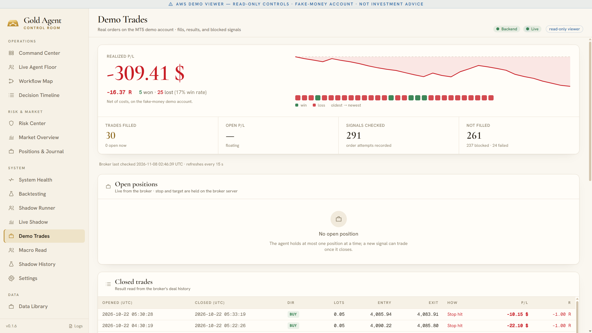
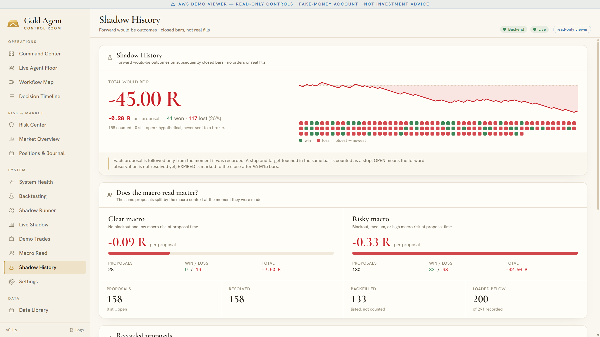
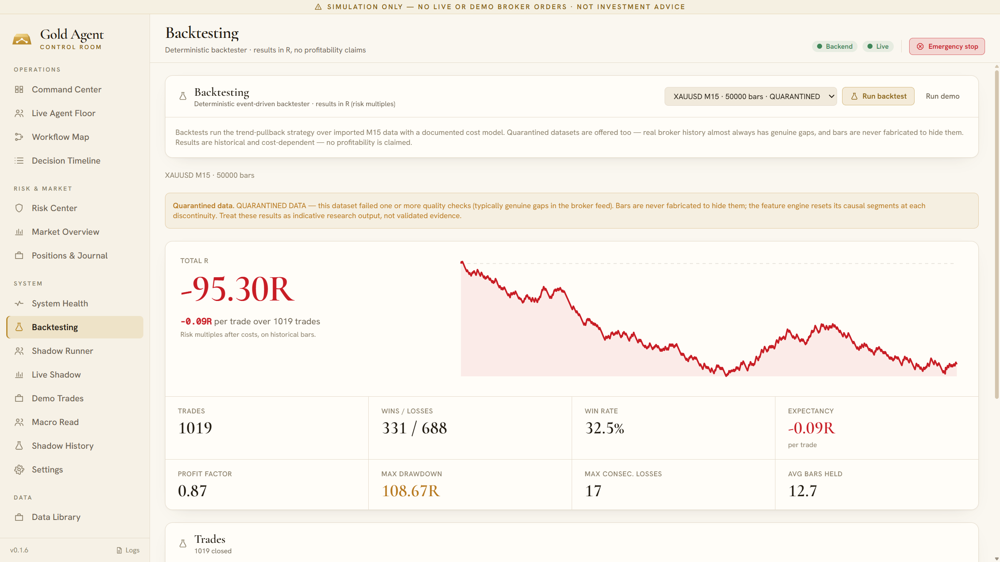
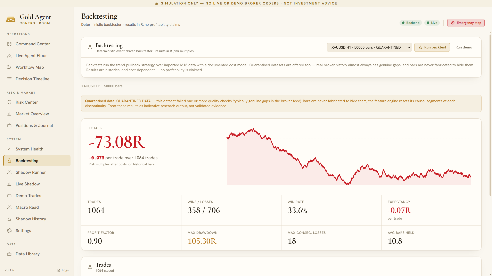
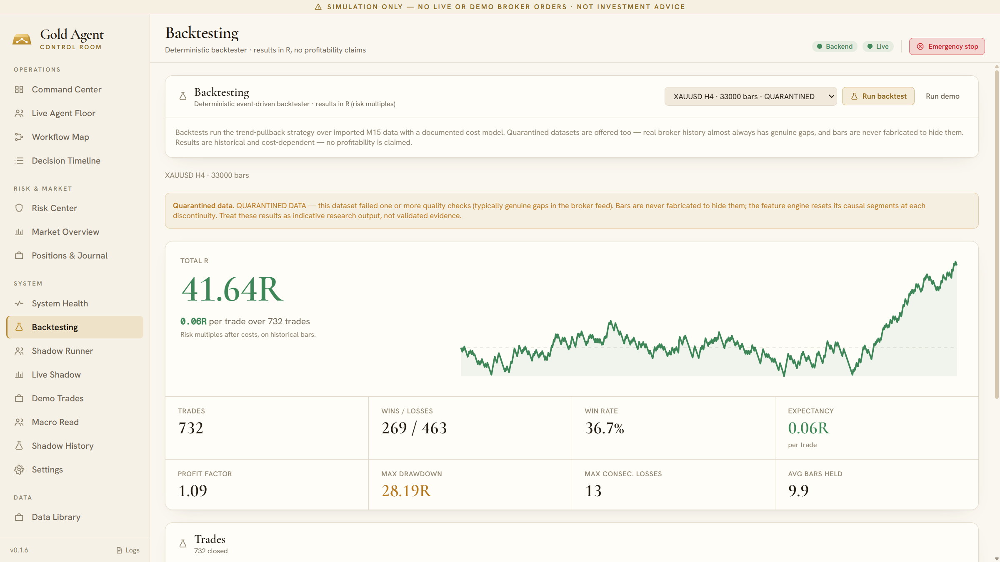
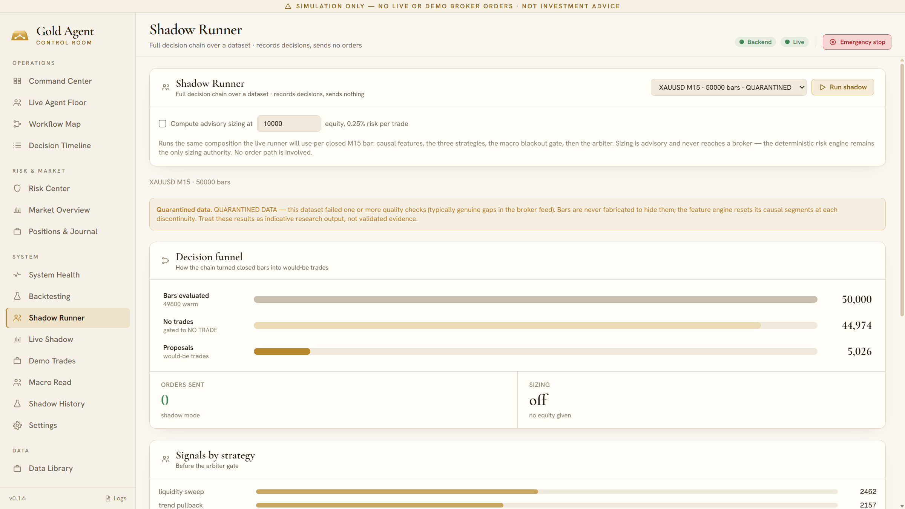

# Results

> **Summary: no strategy has yet shown a winning edge.** The agent team, the risk engine and the audit trail work as designed. The trading strategies they run do not make money on the data tested so far.

All figures are in R — multiples of the amount risked on a trade — so −1R is one full stop-loss and +1.5R is a target hit at 1.5 : 1. Every number below comes from the app's own records.

## 1 · Fake-money demo account (cloud server, MetaTrader 5)

The full team ran around the clock on a cloud server, placing real orders on a fake-money demo account.

| Measure | Value |
|---|---|
| Trades filled | 30 |
| Won / lost | 5 / 25 (17 % win rate) |
| Realized P/L | **−$309.41 · −16.37R** (net of costs) |
| Signals checked | 291 |
| Signals that did not trade | 261 — 237 blocked by a safety gate, 24 refused by the broker |

Why signals were blocked: signal too old (132), news blackout (56), order error at the broker (24), spread too wide (20), reward : risk too low (13), a position already open (13), invalid position size (4). The live loop polled the feed every 60 seconds — 19,506 polls in its latest session.

## 2 · Shadow history (forward tracking, no orders)

Every proposal was followed forward on the bars that closed after it, as if it had been traded.

| Measure | Value |
|---|---|
| Proposals counted | 158 |
| Won / lost | 41 / 117 (26 %) |
| Total | **−45.00R** (−0.28R per proposal) |
| With a clear macro read | 28 proposals · −2.50R (−0.09R each) |
| With a risky macro read | 130 proposals · −42.50R (−0.33R each) |

The macro split is the most useful finding: proposals made while the macro read was risky lost almost four times as much per trade as those made in clear conditions.

## 3 · Backtests (historical data, trend-pullback strategy)

  
  
  

| Dataset | Bars | Trades | Win rate | Expectancy | Profit factor | Max drawdown | Total |
|---|---|---|---|---|---|---|---|
| XAUUSD M15 | 50,000 | 1,019 | 32.5 % | −0.09R | 0.87 | 108.67R | **−95.30R** |
| XAUUSD H1 | 50,000 | 1,064 | 33.6 % | −0.07R | 0.90 | 105.30R | **−73.08R** |
| XAUUSD H4 | 33,000 | 732 | 36.7 % | +0.06R | 1.09 | 28.19R | **+41.64R** |

All three datasets come from broker history with genuine gaps, so they are marked quarantined and these results are indicative, not validated evidence. The H4 result is the only positive one; it has not been confirmed out of sample.

## 4 · Shadow runner (the full team over history)

The shadow runner replays the same composition the live system uses — features, the three strategies, the macro gate and the Arbiter — over every historical bar, and sends nothing.

| Dataset | Bars evaluated | Gated to NO TRADE | Would-be trades | Orders sent |
|---|---|---|---|---|
| M15 | 50,000 | 44,974 | 5,026 | 0 |
| H1 | 50,000 | 45,041 | 4,959 | 0 |
| H4 | 33,000 | 29,804 | 3,196 | 0 |

Nine bars in ten end in NO TRADE — the team is selective by construction.

## What this means

- **The platform works.** Data guards, risk rules, blackouts and the emergency stop all behaved as designed under real broker conditions, and every decision is traceable.
- **The strategies do not, yet.** Technical setups alone lost money on the demo account, in shadow tracking and in two of three backtests.
- **The next step is research, not leverage:** fundamental and macro inputs, which the shadow history already suggests matter, tested offline before anything reaches the demo account again.
