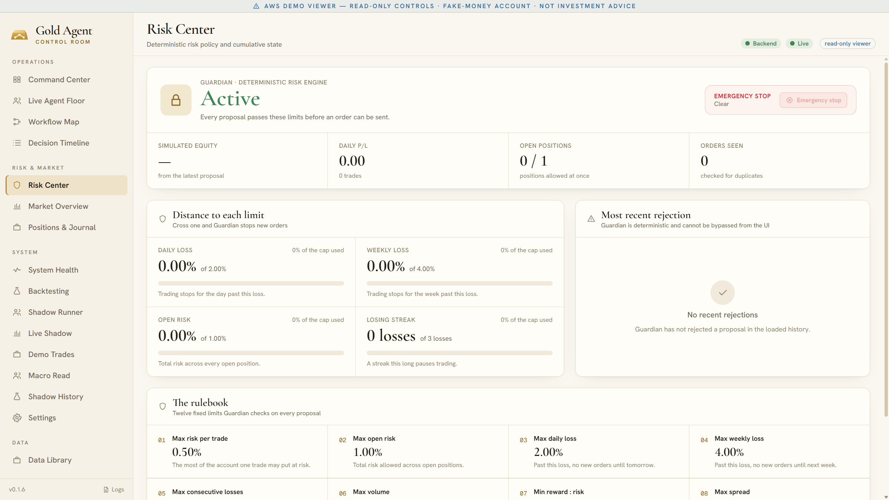

# Safety by design

Gold Agent was designed around one assumption: **any part of the system can be wrong at any time.** Data can be stale, a model can be overconfident, a broker can reject an order, a server can restart mid-trade. Every one of those cases ends the same way — no order, and a record of why.

## NO TRADE is the default

A cycle only produces an order when every step succeeds. These all end in NO TRADE:

- market data that is missing, malformed or older than the freshness limit;
- an analyst that times out or errors;
- conflicting or insufficient evidence at the Arbiter;
- a macro blackout around a high-impact economic event;
- any broken risk rule at the Guardian.

## The Guardian's twelve rules

Fixed limits, checked on every proposal, in code — never chosen by a model.

| # | Rule | Limit on the cloud demo |
|---|---|---|
| 1 | Max risk per trade | 0.50 % of the account |
| 2 | Max open risk | 1.00 % across open positions |
| 3 | Max daily loss | 2.00 % — no new orders until tomorrow |
| 4 | Max weekly loss | 4.00 % — no new orders until next week |
| 5 | Max consecutive losses | 3 — a losing streak pauses trading |
| 6 | Max volume | 0.1 lots per order |
| 7 | Min reward : risk | 1.5 |
| 8 | Max spread | 45 points |
| 9 | Max slippage | 10 points |
| 10 | Max data age | 90 seconds |
| 11 | Max margin fraction | 20 % of free margin |
| 12 | Position limit | 1 open position |

## Emergency stop

One button halts the runner and blocks every new cycle and order. The stop survives a restart and an upgrade, and a reset does not clear it. It can only be lifted through a deliberate, guarded and audited step.

## No live money

- **Live orders are permanently disabled** — the setting cannot be turned on from the interface.
- The cloud demo trades a **fake-money** MetaTrader 5 demo account.
- The desktop connects to the cloud server through a **private tunnel** with a **read-only** credential: it can watch everything and change nothing.
- The local app is locked to simulation.

## Honest measurement

- Backtests charge a documented cost model and never fabricate missing bars. Datasets with genuine gaps are labelled **quarantined** and their results shown as indicative only.
- Shadow history follows each proposal only from the moment it was recorded; a stop and target touched in the same bar counts as a stop; proposals recorded late are listed but not counted.
- Results are reported in R (multiples of the risk taken) and in currency, losses included.
