# The control room, screen by screen

A desktop app for Windows, designed in ivory and gold: one serif for headlines and numbers, a clean sans for text, a mono face for prices and times. Screens marked *local* come from the app in simulation mode; screens marked *cloud demo* come from the read-only viewer connected to the cloud server.

## Workflow Map · *local*
The team on a stage, left to right from the market feed to the audit. Live handoffs glow gold; a NO TRADE outcome lands on its own tile. Select any block to see what that agent just did.

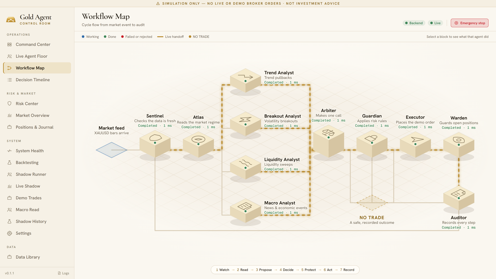

## Command Center · *local*
Price and recent bars, the last decision, the safety ledger, the simulation controls and the whole team in one view.

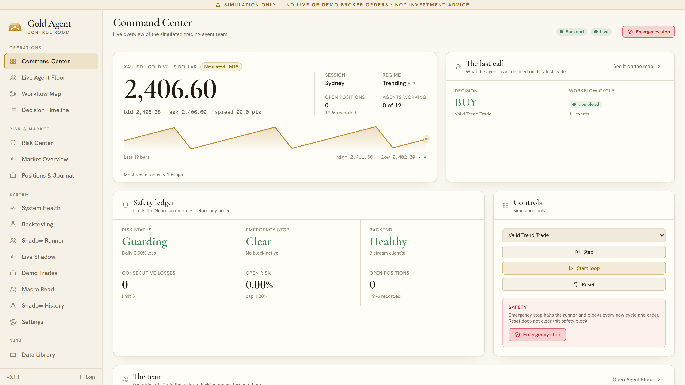

## Live Agent Floor · *local*
All twelve agents grouped by the seven steps of a cycle, each with its state, confidence, timing and handoff.

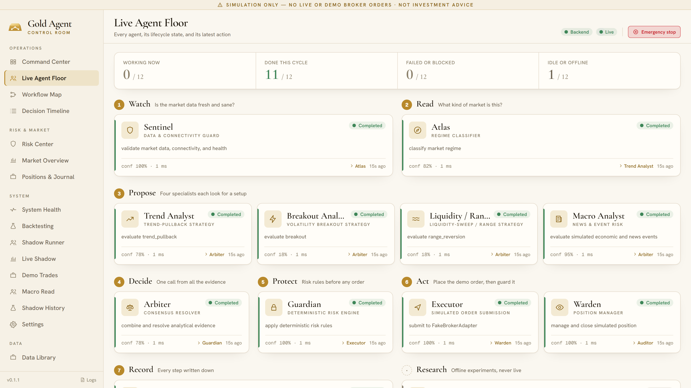

## Decision Timeline · *local*
Every decision on the left; on the right, the full event chain behind the selected one, newest first, searchable and exportable.

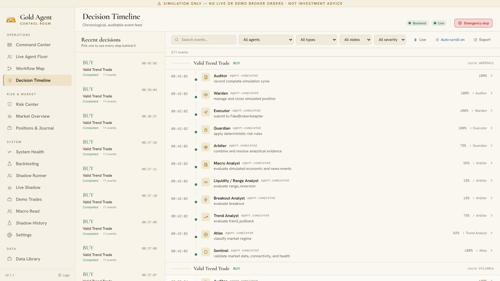

## Market Overview · *local*
Price chart, market ledger, the latest candle, what each analyst sees and the latest proposal through the Guardian.

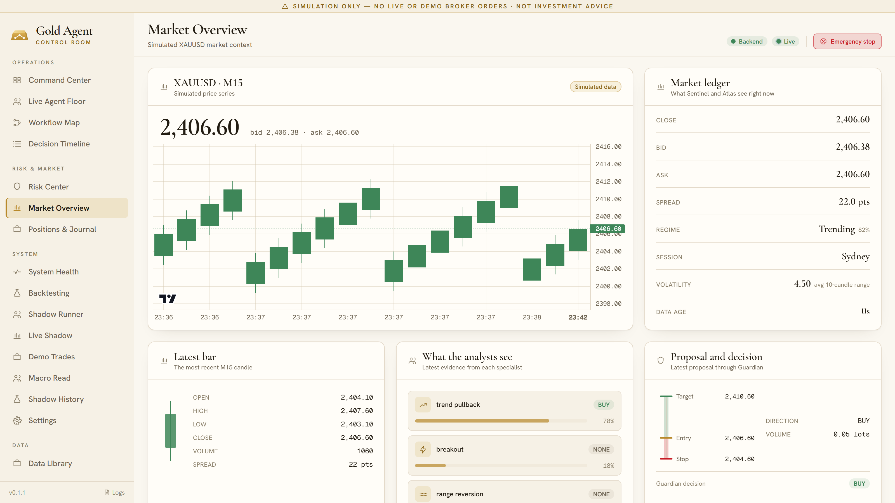

## Risk Center · *cloud demo*
The Guardian's status, the distance to each limit, the most recent rejection and the twelve-rule rulebook.

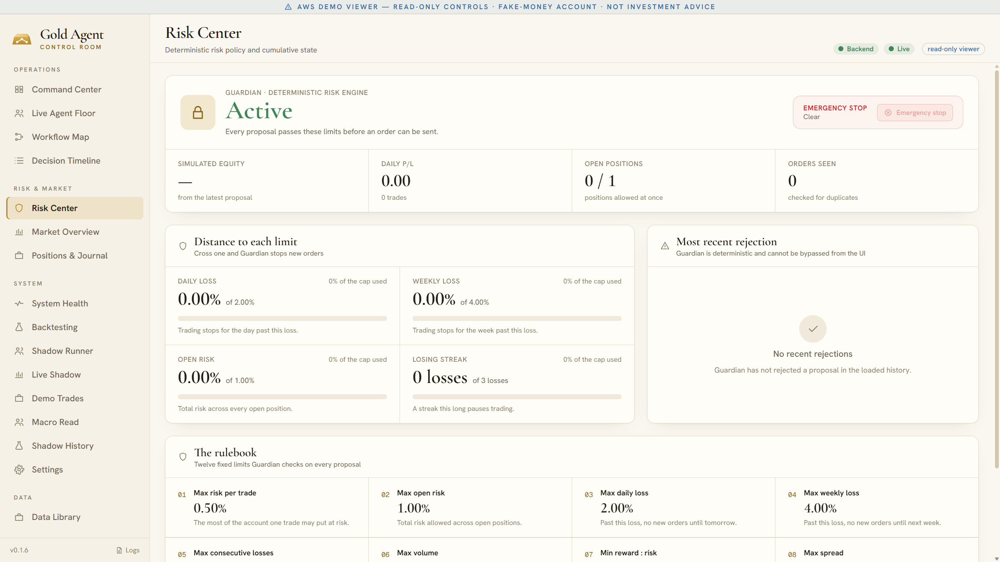

## Live Shadow · *cloud demo*
The live loop on the demo feed: running state, feed freshness, orders, proposals and polls. Shown here on a weekend, when the closed market leaves the feed stale and the loop correctly refuses to act.

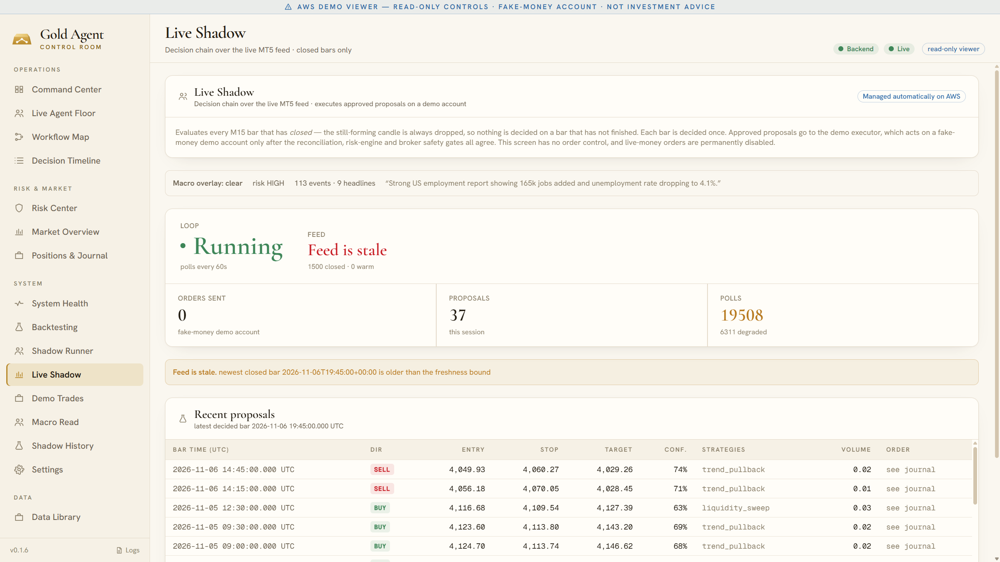

## Macro Read · *cloud demo*
The news-and-calendar verdict in one word, its confidence, and the agent's reasoning.

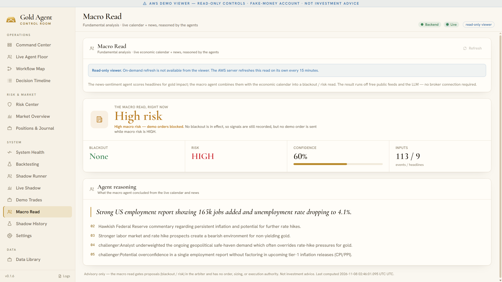

## System Health · *local*
One verdict for the whole system, with a status light for each part and the health of every agent.

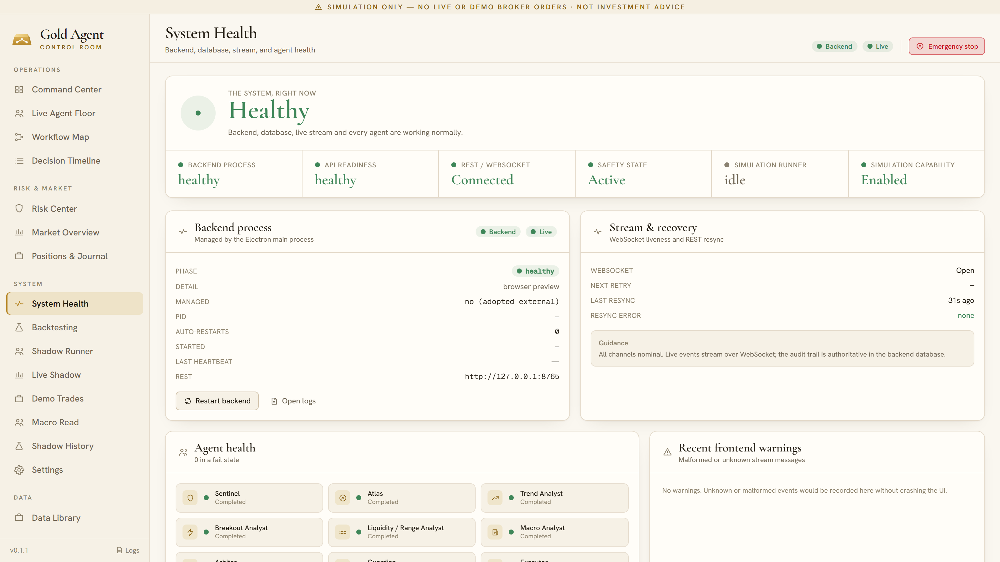

## Settings · *cloud demo*
The locked trading mode and its safety flags. Live orders: false.

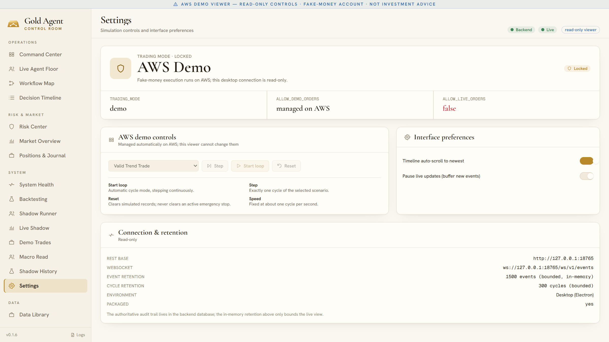

## Data Library · *cloud demo*
Every imported historical dataset with its version, coverage and quality status.

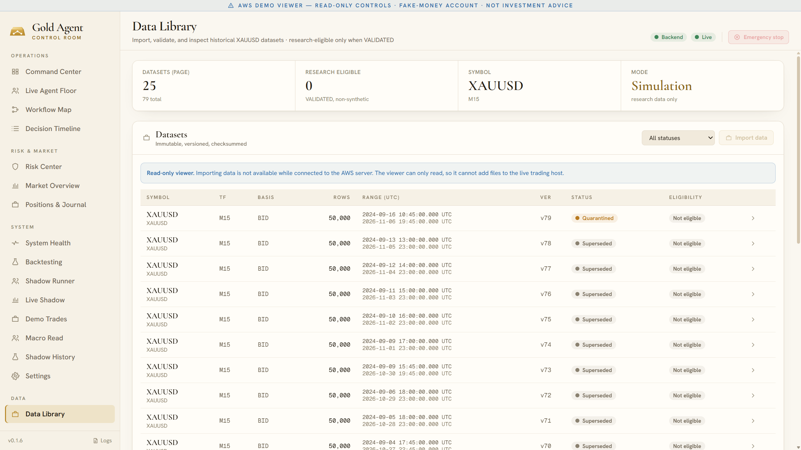

## Results screens
Demo Trades, Shadow History, Backtesting and Shadow Runner are shown with their numbers in [results.md](results.md).
